<picture>
  <source media="(prefers-color-scheme: dark)" srcset="assets/hero-dark.svg">
  
</picture>

A dive instructor but work with data, major in Meteology & Sustainability.

### <picture><source media="(prefers-color-scheme: dark)" srcset="assets/fin-dark.svg"></picture> Work

- [aiwp-china-verification](https://github.com/JoooDev-TPP/aiwp-china-verification): ten global weather models scored at Chinese stations. The best one depends on the variable.
- [cn-weather-cube](https://github.com/JoooDev-TPP/cn-weather-cube): point weather for renewable-energy work. Every number has a unit and every series names its source.
- [Carbon-Footprint-LCA](https://github.com/JoooDev-TPP/Carbon-Footprint-LCA): 100 MW of solar avoids 65% more CO2 in China's North grid than in the South.
- [GBA-Air-Quality-Analysis](https://github.com/JoooDev-TPP/GBA-Air-Quality-Analysis): Greater Bay Area air, 2015 to 2024. PM2.5 halved. Ozone did not move.
- [green-ai-ledger](https://github.com/JoooDev-TPP/green-ai-ledger): carbon for a compute job, with the grid factor taken from a cited source instead of your IP.

I half hope AI replaces me soon, so I can dive every day, plant coral and work on mitigation full time.

<picture>
  <source media="(prefers-color-scheme: dark)" srcset="assets/reef-dark.svg">
  
</picture>
